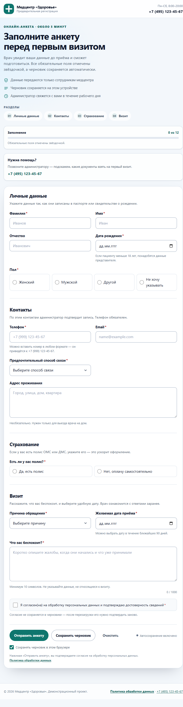

# medical-intake-form

[](https://github.com/VEYMK/medical-intake-form/actions/workflows/ci.yml)

Динамическая анкета пациента для медицинского центра: семантический HTML, адаптивная
вёрстка на CSS Grid/Flexbox, валидация на чистом JavaScript, маска телефона и
автосохранение черновика в `localStorage`.



> Демонстрационный проект. Анкета не отправляет данные на сервер: в демо-режиме
> номер заявки генерируется на клиенте. Точка интеграции с бэкендом —
> атрибут `data-endpoint` у формы.

---

## 1. Быстрый старт

### Самый простой способ — открыть `index.html`

Двойной клик по `index.html`. Не нужны ни сервер, ни сборка, ни `npm install`.

Почему это работает: `index.html` подключает `js/bundle.js` — обычный classic-скрипт.
Исходники лежат в читаемых ES-модулях `js/*.js` (их используют тесты), а бандл
собирается из них командой `npm run build`. ES-модули напрямую через `file://` браузер
блокирует, потому что origin равен `null`; classic-бандл эту проблему снимает.

После правок в `js/*.js` пересоберите бандл:

```bash
npm run build
```

### Локальный сервер (опционально)

Нужен Node.js 20+ (проект проверен на Node 24). Зависимостей нет.

```bash
npm start       # собирает бандл и поднимает сервер на http://localhost:5173
```

### Docker — одной командой

```bash
docker compose up --build
```

Откройте <http://localhost:8080>. Внутри — nginx с готовыми статическими файлами.

### Тесты и статические проверки

```bash
npm test        # 42 unit-теста на встроенном node:test
npm run check   # уникальность id, наличие ассетов, CSP-совместимость, aria-ссылки
```

---

## 2. Почему такая структура HTML

Разметка страницы — это не «набор div’ов», а карта документа для браузера,
скринридера и поисковика.

| Решение | Зачем |
|---|---|
| `header`, `main`, `aside`, `footer` | Лендмарки, по которым можно прыгать в скринридере и по которым строится оглавление страницы. |
| Один `h1` + `h2` у каждой секции | Плоская и предсказуемая иерархия заголовков. По `h2` работают навигация и кнопка «к разделу». |
| `section` + `aria-labelledby` | Каждый блок анкеты — самостоятельная область с заголовком, а не визуальная группа. |
| `fieldset` + `legend` для radio | Группа радиокнопок получает общее имя. Скринридер читает «Пол, Женский, радиокнопка, 1 из 4», а не просто «Женский». |
| `label for` у каждого поля | Клик по подписи фокусирует поле; подпись озвучивается вместе с контролом. Подписи не заменяются placeholder’ами. |
| `aria-describedby` | Подсказка и сообщение об ошибке связаны с конкретным полем, а не просто лежат рядом. |
| Нативные `input type="date"`, `tel`, `email`, `select` | Мобильные клавиатуры, встроенный календарь, автозаполнение и корректная семантика — бесплатно. |
| `novalidate` на форме | Браузер не показывает свои всплывающие сообщения: тексты ошибок единообразны, на русском и доступны скринридеру. |
| `button type="button"` у вторичных действий | Кнопки «Сохранить черновик», «Очистить» и «Политика» не отправляют форму случайно. |
| `dialog` для подтверждения очистки | Нативный модальный диалог сам ловит фокус, закрывается по Esc и возвращает фокус на кнопку. |
| `noscript` | Если JS отключён, пользователь видит телефон администратора, а не пустой экран. |

Форма **не** собирается через `innerHTML`: renderer (`js/form-builder.js`) создаёт
DOM-узлы через `document.createElement`, поэтому пользовательские данные не могут
попасть в разметку как HTML. Это одновременно защита от XSS и гарантия того, что
`label`, `legend`, `aria-*` и `id` всегда согласованы.

Схема формы (`js/schema.js`) — единственный источник правды: поля, типы, подсказки,
условия видимости и обязательности. Из неё одновременно строятся DOM, валидация,
прогресс и черновик. Добавление поля — одна запись в схеме, а не правки в пяти местах.

---

## 3. Клавиатурная доступность

Проверено вручную в браузере: порядок Tab совпадает с визуальным порядком.

1. **Skip link.** Первый Tab показывает «Перейти к анкете». Enter переводит фокус на
   форму (`tabindex="-1"`), а не просто прокручивает страницу.
2. **Логичный tab-порядок.** Skip link → логотип → телефон → разделы → поля формы →
   действия → политика. Никаких `tabindex` больше нуля, которые ломают порядок.
3. **Радиогруппы.** Внутри группы работает навигация стрелками (нативное поведение
   radio), Tab переходит к следующей группе, а не к каждой кнопке.
4. **Сводка ошибок.** После неудачной отправки фокус переходит в `role="alert"`;
   каждая ошибка — ссылка, которая фокусирует конкретное поле и прокручивает к нему.
5. **Ошибки у полей.** `aria-invalid="true"` + `aria-describedby` на текст ошибки.
   Ошибка появляется после blur или повторного ввода, а не при каждом нажатии клавиши.
6. **Диалоги.** Нативный `<dialog>` удерживает фокус, закрывается по Esc и возвращает
   фокус туда, откуда его открыли.
7. **Видимый фокус.** `:focus-visible` с контрастным outline не отключается нигде;
   у полей — дополнительное кольцо. В режиме `forced-colors` ошибки и выбранные
   варианты помечаются системными цветами.
8. **Живые регионы.** Статус сохранения, восстановление черновика и успешная отправка
   объявляются через `role="status"` / `aria-live="polite"`.
9. **Размер целей.** Кнопки, поля и карточки выбора — не меньше 48 px по высоте.
10. **Motion.** При `prefers-reduced-motion` отключаются плавные прокрутки и анимации.

---

## 4. Валидация: граничные случаи

Валидация написана как чистые функции (`js/validators.js`, `js/formatters.js`) и
покрыта unit-тестами. Ниже — то, что легко пропустить.

### Обязательность и пустота

- Пустая строка, строка из пробелов, `null` и `false` считаются пустыми.
- Текст ошибки зависит от контрола: «Заполните это поле», «Выберите один из
  вариантов», «Выберите значение из списка», «Подтвердите согласие».
- Необязательные поля (отчество, адрес) не блокируют отправку, но проверяются, если
  в них что-то введено.

### Имена

- Разрешены Unicode-буквы (кириллица, латиница), пробел, дефис и апостроф:
  `Анна-Мария`, `О'Брайен`, `ван дер Берг`.
- Лишние пробелы схлопываются, значение обрезается по краям при blur.
- Длина 2–60 символов; цифры и спецсимволы отклоняются.

### Email

- Общая длина ≤ 254, локальная часть ≤ 64, домен ≤ 253.
- Ровно один `@` (проверяется `lastIndexOf`), локальная часть не начинается и не
  заканчивается точкой, не содержит `..`.
- Домен разбивается на метки: каждая 1–63 символа, не начинается и не заканчивается
  дефисом, состоит из букв/цифр/дефиса.
- TLD — только буквы, минимум 2 символа. Поддерживаются IDN-домены (`иван@example.рф`).
- Плюс-адресация (`name+tag@example.co.uk`) разрешена.
- Пробелы внутри адреса отклоняются.
- Это UX-проверка; окончательно адрес должен проверять сервер (и подтверждение письмом).

### Телефон и маска

- Принимаются `+7…`, `8…` и просто 10 цифр; всё приводится к `+7 (999) 123-45-67`.
- Маска строится прогрессивно: `+7`, `+7 (9`, `+7 (999)`, `+7 (999) 1` и т.д.
- Вставка номера в любом формате очищает нецифровые символы и форматирует заново.
- Каретка после маски ставится после введённой цифры, а не в конец поля.
- Backspace на одном символе очищает поле, а не оставляет `+7`.
- Больше 11 цифр не принимается; `maxlength` учитывает пробелы и скобки.
- Валидация требует ровно 11 цифр — частичный номер не проходит.

### Даты

- `YYYY-MM-DD` парсится как **локальная** дата, а не UTC, поэтому часовой пояс не
  сдвигает день рождения на сутки.
- Невозможные даты (`2026-02-30`, `2026-13-01`) отклоняются, а не «перекатываются»
  в следующий месяц, как это делает `new Date()`.
- Дата рождения не может быть в будущем; возраст ограничен 120 годами.
- Дата приёма — от сегодня до +90 дней; `min`/`max` у `input type="date"`
  пересчитываются при возвращении на вкладку.
- Возраст считается по локальным частям даты, поэтому 18-летие наступает в день
  рождения, а не на сутки раньше/позже.

### Условные поля

- **Несовершеннолетний пациент.** Если дата рождения даёт возраст < 18, появляются и
  становятся обязательными ФИО и телефон законного представителя.
- **Страховка.** При `hasInsurance = yes` появляются номер полиса и страховая; при
  `no` — скрываются.
- **Другая страховая.** При `insurer = other` появляется текстовое поле названия.
- Скрытые поля **очищаются** и **пропускаются** при валидации и отправке: старые
  значения не утекают в payload и не блокируют форму.
- `required` и `aria-required` пересчитываются динамически.

### Прочие поля

- Полис ОМС — ровно 16 цифр, автоматически группируются по четыре.
- Жалобы — минимум 10 символов, максимум 1000, с живым счётчиком и предупреждением
  при приближении к лимиту.
- Адрес — до 300 символов, необязателен.
- Согласие — отдельный чекбокс; без него отправка невозможна.

### Отправка

- Повторная отправка блокируется флагом `submitting` и `disabled` на кнопке.
- На время запроса кнопка получает `aria-busy="true"` и текст «Отправляем…».
- Ошибка сети не теряет данные: черновик остаётся, пользователь видит сообщение.
- После успеха черновик удаляется, форма скрывается, фокус переходит на панель успеха.

---

## 5. Черновик и приватность

Черновик хранится в `localStorage` под ключом `med-intake:draft`.

- **Версия схемы.** При изменении структуры формы старый черновик удаляется
  (`status: "stale"`), а не ломает рендер.
- **TTL 7 дней.** Просроченный черновик удаляется при загрузке.
- **Согласие не сохраняется.** Чекбокс обработки персональных данных намеренно
  исключён: после перезагрузки его нужно подтвердить заново. Это и юридически
  корректнее, и честнее по отношению к пользователю.
- **Повреждённый JSON** удаляется, форма открывается пустой.
- **Переполнение хранилища** (`QuotaExceededError`) и недоступный `localStorage`
  (приватный режим, запрет cookies, sandboxed iframe) не роняют форму: автосохранение
  отключается, пользователь видит понятный статус.
- **Автосохранение** с debounce 450 мс; есть кнопка ручного сохранения и переключатель
  «Сохранять черновик в этом браузере».
- **Закрытие вкладки.** `beforeunload` предупреждает, только если есть
  несохранённые изменения; `pagehide` и `visibilitychange` делают последнюю попытку
  сохранения.
- **Две вкладки.** Событие `storage` показывает баннер «черновик обновлён в другой
  вкладке» и предлагает перезагрузиться, чтобы не затереть чужие изменения.
- **Очистка.** Кнопка «Очистить» спрашивает подтверждение в `<dialog>` и удаляет и
  поля, и черновик.
- **После отправки** черновик удаляется.

> `localStorage` не шифрует данные и доступен любому JS на этом origin. Для реальных
> медицинских данных это недопустимо: в продакшене черновик должен жить на сервере
> за аутентификацией, с шифрованием, аудитом доступа и сроком хранения. В демо не
> вводите настоящие персональные данные.

---

## 6. Технические решения

| Решение | Почему |
|---|---|
| **Schema-driven форма** | Одна схема управляет разметкой, валидацией, условиями и черновиком. Легко тестировать и расширять. |
| **Чистый JS: ES-модули + classic-бандл** | Требование задачи; заодно видно работу с DOM, событиями, формами и доступностью без фреймворка. Исходники — ES-модули, а `js/bundle.js` собирается в classic-скрипт, чтобы страница открывалась двойным кликом через `file://`. |
| **Ноль runtime-зависимостей** | `npm install` не нужен, атака на supply chain минимальна. Бандлер — свой, на 100 строк, без esbuild/Vite. |
| **Свой статический сервер** | Нужен только для удобной разработки по HTTP. `scripts/serve.mjs` — 50 строк на `node:http`, без Express. Для просмотра достаточно `index.html`. |
| **Node test runner** | Встроенный `node:test` не требует Jest/Vitest и проверяет чистые функции без DOM. |
| **`localStorage` + версия + TTL** | Простое решение задачи «пережить F5»; версия и TTL защищают от устаревших и битых данных. |
| **Без «ненастоящей» аутентификации** | Анкета публичная: пациент не должен регистрироваться, чтобы записаться. Фейковый логин был бы security theater. В продакшене — TLS, серверная валидация, rate limiting, CSRF, капча и отдельный вход для персонала. |
| **CSP без `unsafe-inline`** | Вся логика и стили — внешние файлы. Это ломает inline-инъекции и заодно дисциплинирует код. |
| **Docker + nginx alpine** | Одна команда запуска, маленький образ, gzip, security-заголовки и healthcheck. |
| **GitHub Actions** | Тесты, статические проверки, сборка образа и smoke-тест контейнера на каждый push. |

### Почему не React

Задача прямо требует чистый JS. Кроме того, форма — это в первую очередь семантика,
нативные контролы и аккуратная работа с фокусом; здесь фреймворк не даёт выигрыша,
а добавляет бандл и слой абстракции. Схема + renderer дают ту же декларативность,
что и React-форма, но без зависимостей.

### Демо-режим и интеграция с бэкендом

Сейчас `data-endpoint` пустой, поэтому `submitIntake()` имитирует задержку сети и
генерирует номер заявки на клиенте. Чтобы подключить реальный API, достаточно указать
URL в атрибуте:

```html
<form id="intake-form" data-endpoint="https://api.example.com/intake">
```

Код отправит `POST` с JSON и `Content-Type: application/json`, а номер заявки возьмёт
из поля `reference` ответа. Сервер обязан **повторно провалидировать все поля**:
клиентская валидация — только UX.

---

## 7. Структура проекта

```
medical-intake-form/
├── index.html                 # семантический каркас, диалоги, панель успеха
├── css/
│   └── styles.css             # токены, mobile-first grid, focus/error/print стили
├── js/
│   ├── schema.js              # поля, секции, условия видимости и обязательности
│   ├── form-builder.js        # построение семантического DOM из схемы
│   ├── validators.js          # чистые функции валидации
│   ├── formatters.js          # маска телефона/полиса, локальные даты, возраст
│   ├── draft.js               # версионированный localStorage-черновик с TTL
│   ├── app.js                 # события, маска, автосохранение, отправка, фокус
│   └── bundle.js              # сгенерированный classic-скрипт для file://
├── tests/                     # 42 unit-теста (node:test)
├── scripts/
│   ├── build.mjs              # сборка ES-модулей в js/bundle.js
│   ├── serve.mjs              # локальный статический сервер
│   └── check.mjs              # статические проверки HTML и ассетов
├── assets/favicon.svg
├── docs/screenshot.png
├── Dockerfile                 # nginx:1.27-alpine + статика
├── nginx.conf                 # gzip, CSP, security-заголовки
├── docker-compose.yml         # docker compose up --build → :8080
└── .github/workflows/ci.yml   # тесты, проверки, docker build, smoke test
```

---

## 8. Тесты

`npm test` — 42 теста:

- **formatters** — нормализация и маска телефона, маска полиса, каретка, локальные
  даты, невозможные даты, возраст, граница 18 лет.
- **validators** — имена, email (валидные и битые кейсы), телефон, даты, полис,
  жалобы, обязательность по типам контролов, условные guardian/insurance поля.
- **draft** — сохранение/восстановление, версия, TTL, битый JSON, quota, недоступное
  хранилище, отдельные настройки, очистка.
- **schema** — уникальность имён, наличие label/options, условия видимости,
  обязательность согласия.

`npm run check` дополнительно проверяет:

- ровно один `h1`, наличие `main`, `lang="ru"`, `novalidate`;
- уникальность всех `id`;
- существование CSS/JS/иконки и подключение `js/bundle.js`;
- отсутствие inline `<script>` и `style="..."` (иначе CSP их заблокирует);
- что все `aria-labelledby`/`aria-describedby` ссылаются на существующие `id`.

CI дополнительно запускает `npm run build` и `git diff --exit-code -- js/bundle.js`:
если исходники изменили, а бандл не пересобрали, пайплайн падает.

---

## 9. Docker и CI

`Dockerfile` — один этап: `nginx:1.27-alpine`, в который копируются только статические
файлы. В образ не попадают тесты, скрипты и README (см. `.dockerignore`). Есть
`HEALTHCHECK`; `nginx.conf` добавляет gzip, `X-Content-Type-Options`, `X-Frame-Options`,
`Referrer-Policy`, `Permissions-Policy` и CSP.

`docker-compose.yml` публикует порт `8080`, включает `no-new-privileges` и healthcheck.

GitHub Actions (`.github/workflows/ci.yml`):

1. `npm test` — unit-тесты;
2. `npm run check` — статические проверки;
3. `npm run build` + `git diff --exit-code -- js/bundle.js` — бандл пересобран и закоммичен;
4. `docker build` — сборка образа;
5. запуск контейнера и `curl`-проверка, что страница отвечает.

---

## 10. Ограничения

- Это фронтенд-демо: данные никуда не отправляются, номер заявки генерируется локально.
- `localStorage` не подходит для реальных медицинских данных (см. раздел 5).
- Нет e2e-тестов в браузере и автоматического аудита доступности (axe/Lighthouse).
- Нет интернационализации: тексты на русском.
- `input type="date"` и `<dialog>` требуют современного браузера; для старых есть
  текстовые fallback’и, но не полная поддержка.
- Поведение `localStorage` на `file://` зависит от браузера: Chrome работает, но для
  реального использования нужен HTTP-сервер. Это ещё одна причина не хранить здесь
  настоящие медицинские данные.
- Docker-образ собирается и проверяется в CI; локально Docker может быть не установлен.

---

## 11. Что бы я улучшил при большем времени

1. **Бэкенд и серверная валидация.** REST-эндпоинт, схема JSON, проверка на сервере,
   запись в PostgreSQL, идемпотентность по клиентскому `requestId`.
2. **Безопасность.** TLS, аутентификация персонала, CSRF, rate limiting, капча,
   аудит доступа, шифрование данных at rest, политика хранения и удаления.
3. **E2E-тесты.** Playwright: заполнение, маска, условные поля, черновик после reload,
   отправка, клавиатурная навигация. Плюс `@axe-core/playwright`.
4. **Тестирование со скринридерами.** NVDA/JAWS/VoiceOver: проверить объявления ошибок
   и живых регионов в реальном использовании.
5. **Пошаговая форма.** Разбить длинную анкету на шаги с сохранением прогресса и
   возможностью вернуться назад без потери данных.
6. **Серверный черновик.** Продолжать заполнение на другом устройстве после
   аутентификации по SMS/email.
7. **Наблюдаемость.** Ошибки клиента, метрики конверсии формы, время заполнения,
   отказы на конкретных полях.
8. **Интеграции.** Слоты расписания, выбор врача, загрузка документов, оплата,
   уведомления SMS/email.
9. **PWA/offline.** Service worker для работы при нестабильной связи и установки на
   телефон.
10. **i18n.** Вынести тексты в словари, добавить английский и другие языки.
11. **Нормальная сборка.** Если проект вырастет, заменить самописный бандлер на
    esbuild/Vite с source maps и минификацией; сейчас 6 модулей и 60 КБ — overkill
    не нужен.
